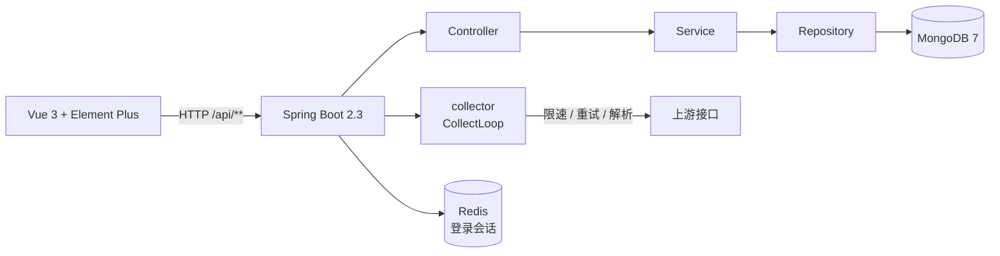

<div align="center">
  
</div>

<p align="center">
  
  
  
  
  
</p>

# BookCollector Admin

**一个面向个人 / 小团队的图书采集可视化后台。** 把「发现书 → 采书 → 治理 → 发布」做成一个可操作、可观察、可断点续传的单机应用。

后端 Spring Boot 2.3 + MongoDB，前端 Vue 3 + Element Plus。**不需要 Docker、不需要云服务**，本地起 MongoDB / Redis 就能跑。

## 亮点

- **可视化**：采集进度、运行日志、请求审计、数据分布，都在页面上看得到。
- **可续传**：游标按「目标」持久化，重启 / 取消 / 失败后从断点继续；付费精选单独记断点与状态。
- **幂等**：`bookId` 唯一索引 + upsert，重复采集不产生重复数据。
- **克制**：不引入不必要的中间件；限速、重试、暂停都是自己写的十几行。

## 功能模块

| 分组 | 模块 | 能力                                                                                                          |
|---|---|-------------------------------------------------------------------------------------------------------------|
| 数据看板 | **仪表盘** | 4 个指标卡 + 4 张 ECharts 图（评分 / 年份 / 分类 / 趋势）；分类分布只显示一级分类；「今日新增」可点开当天明细                                         |
| 数据看板 | **图书库** | 多条件筛选（二级分类级联、书名 / 作者包含匹配、付费精选等）、服务端分页排序、列显隐持久化、详情抽屉 59 个字段、只提交被改过的字段、批量删除                                   |
| 数据看板 | **书架** | 我的藏书 + 阅读清单（读本地集合，不依赖上游接口）                                                                                  |
| 采集目标 | **分类配置** | 分类 / 榜单字典维护与启停；删除前检查任务引用；首次启动自动 seed                                                                        |
| 采集目标 | **书单配置** | 16 个平台分类一键发现书单（书数 ≥ 50 且 收藏 ≥ 10000）；筛选 / 分页 / 详情；**新增书单**、**完善书单信息**（覆盖更新）、**同步书单书籍**（进度 + 暂停 / 继续 + 断点续采） |
| 采集目标 | **付费精选配置** | 按一级分类（enabled）分页采集付费精选书籍；**暂停 / 继续 / 停止**、**断点续采**、**状态持久化**；已有书只补来源与 `paidCollect`，不覆盖其它字段；身份失效自动暂停        |
| 采集执行 | **任务配置** | 任务增删改查 + 启动 / 暂停 / 恢复 / 取消 / 重试；7 状态机；一个目标只允许一个任务；详情 3 个 Tab；重启自动标 `INTERRUPTED`                            |
| 采集执行 | **增量配置** | 8 个目标一键或按 cron 全量刷新；不建任务、不碰游标；与手工任务共享同一把锁                                                                   |
| 采集执行 | **采集游标** | 查看每个目标采到哪了；「重置到 0」与「指定起点」；游标归属目标，重建任务不丢进度                                                                   |
| 采集执行 | **请求审计** | 每次上游调用记录页码 / 状态码 / 耗时 / 条数 / 失败原因；只读；失败高亮；支持回放诊断                                                            |
| 内容发布 | **精选图书** | 候选清单 + 精选配置弹窗（分类 / 评价标题 / 推荐值 / 书名作者，预览 + 批量或全量精选）；6 个数值列可排序                                                |
| 内容发布 | **AI 书籍解读** | 一次一本：生成 → 存成 Markdown → 发到语雀；发布记录含合规替换的原词                                                                   |
| 系统 | **登录** | Sa-Token 签发 token、会话落 Redis；登出真失效；密码存 MD5                                                                   |

## 技术栈

| 层 | 组件 |
|---|---|
| **后端** | Java **8** · Spring Boot **2.3.12** · Spring Data MongoDB（驱动 4.0.6）· Apache HttpClient 4.5 · fastjson2 · springdoc 1.6.15 · Lombok · Maven |
| **前端** | Vue 3.4 · Vite 5.2 · TypeScript 5.4（严格模式）· Element Plus 2.7 · Pinia · Vue Router · ECharts 5.5 · Axios |
| **存储** | MongoDB 7.0（业务数据唯一权威）· Redis 3.2（**必需**，登录会话存在这里） |

## 架构



**一次采集任务的完整链路**

```
① 建任务   POST /api/tasks          写 collect_tasks（(targetType, targetId) 唯一）
② 启动     POST /api/tasks/{id}/start
             └─ 读游标 collect_cursors 拿起点
             └─ 申请采集权（同目标互斥）
             └─ 异步提交到采集线程池，立即返回
③ 执行     CollectLoop 分页主循环（每页）：
             限速 → 请求 → 解析 → 先 upsert 落库 → 再推进游标 → 写审计 + 进度
④ 收尾     写 run 终态 → 更新任务状态 → 释放采集权
```

关键点：**先落库、再推游标**。中途崩了游标也不会跑到数据前面，重跑最多重复写入（upsert 幂等），不会漏数据。

## 数据模型

23 个 MongoDB 集合（库名 `bookcollector`），索引在启动时由 `MongoIndexInitializer` 显式创建，并带「字段漂移自愈」。

| 分组 | 集合 |
|---|---|
| 采集数据 | `books`（唯一索引 `bookId`） |
| 采集目标 | `taxonomy_config` · `booklists` |
| 任务与游标 | `collect_tasks` · `collect_task_runs` · `collect_task_logs` · `collect_cursors` |
| 付费精选 | `paid_collect_state`（断点 + 状态） |
| 审计与系统 | `api_requests` · `settings` · `sys_user` · `weread_credential`（接口凭证） |
| 书架 | `shelf_books` · `reading_list` |
| 定时刷新 | `refresh_jobs` |
| AI 解读 / 发布 | `book_interpretations` · `ai_publish_job` · `publish_record` · `pick_taxonomy_config` |
| AI 配置（手工维护） | `ai_model` · `ai_yuque_token` · `ai_taxonomy_config` · `ai_sensitive_words` |

---

<p align="center">
  <sub>本项目仅用于个人学习与技术研究，采集数据请勿用于商业用途；请遵守目标站点服务条款并自行控制采集频率。</sub>
</p>
